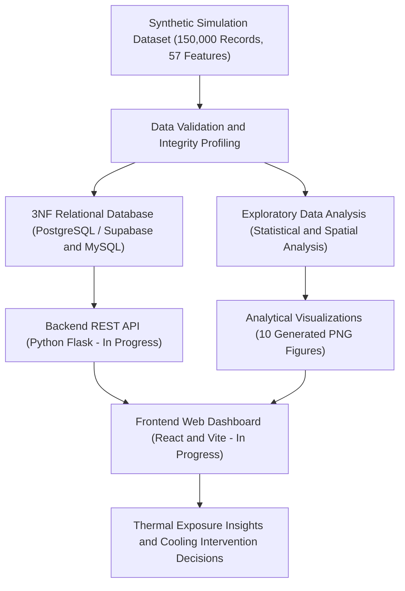
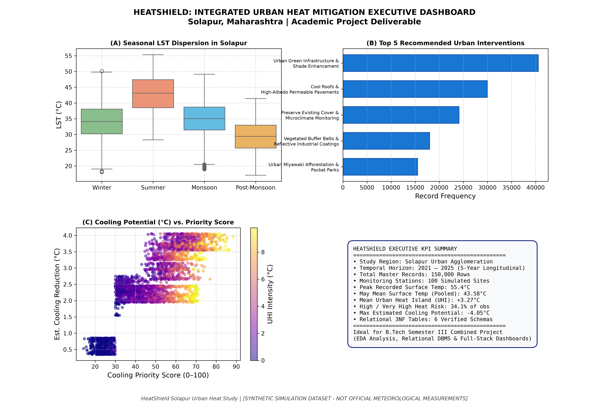
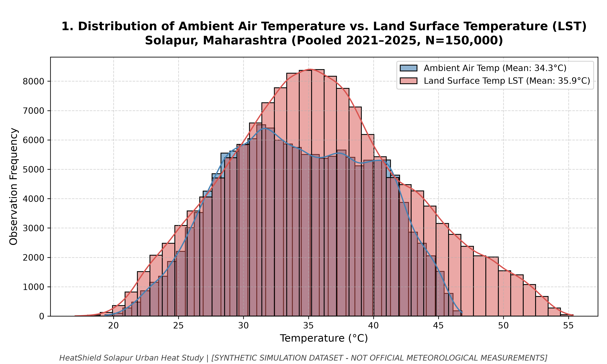

<p align="center">
  
  &nbsp;&nbsp;<b>Made For Indians — Made By Indians</b>&nbsp;&nbsp;
  
</p>

<p align="center">
  
</p>

<p align="center">
  
</p>

# HeatShield — Urban Heat Exposure Analysis and Cooling Intelligence Platform

[](#project-status-and-academic-context)
[](#team-name-members-and-work-distribution)
[](#database-design)
[](#dataset-and-data-integrity-disclosure)

---

## GitHub and Deployment Readiness

This repository is configured for professional GitHub collaboration and Vercel-ready frontend deployment.

- Frontend root: repository root itself (`React + Vite + Tailwind + Leaflet + Recharts`)
- Backend status: no working Flask service is currently committed in this repository; the project is still in the frontend + data/analytics stage
- Vercel: the frontend is ready for a standard Vite deployment with SPA rewrite support via `vercel.json`
- Render: no backend code is present yet, so a Render service is intentionally not created until the Flask API is added and verified
- CI: a minimal GitHub Actions workflow runs `npm ci` and `npm run build` on push and pull request

This keeps the current repo clean, reproducible, and deployable without inventing a nonfunctional backend.

---

## Team Name, Members, and Work Distribution

### Team Identifier: **TF-141**
**Institution**: MIT Vishwaprayag University (MIT-VPU), Solapur  
**Course Track**: Semester III Integrated Project (FSD-1 + DBMS + EDADV)

| Team Member | Student ID | Primary Responsibility | Key Deliverables |
|---|---|---|---|
| **Furqan Bagwan** | `SCFU425004` | **Frontend** | User interface design, responsive layout, dashboard views, data filters, interactive maps, and component architecture. |
| **Aman Shaikh** | `SCFU425013` | **Exploratory Data Analysis & Data Visualization (EDADV)** | Data cleaning, statistical profiling, correlation modeling, QA validation reports, and publication-ready analytical charts. |
| **Bhavin Shankur** | `SCFU425014` | **Backend and Database** | 3NF relational schema design, PostgreSQL/Supabase and MySQL DDL migrations, ETL loading logic, and REST API specification. |

---

HeatShield is an academic urban heat exposure analysis and cooling-intelligence platform developed for the **Solapur Urban Agglomeration, Maharashtra, India** (covering the simulation period 2021–2025). Built as an integrated Semester III project combining **Full Stack Development (FSD)**, **Database Management Systems (DBMS)**, and **Exploratory Data Analysis and Data Visualization (EDADV)**, HeatShield computationally organizes microclimate data, examines thermal exposure dynamics, and models cooling intervention priorities.

### The Problem HeatShield Addresses
Urban environments frequently experience pronounced spatial variations in temperature due to surface composition and human activity:
* **Thermal Disparities**: Densely built commercial and industrial sectors experience elevated land surface temperatures (LST) compared to vegetated areas.
* **Environmental Drivers**: Variations in vegetative density (NDVI), built-up surface intensity (NDBI), tree canopy coverage, surface albedo, and atmospheric radiation drive urban heat dynamics.
* **Decision Support**: Quantitative modeling of shade deficits, vegetative cover deficits, and exposure risks allows municipal planners to identify, evaluate, and prioritize potential cooling interventions.

> **Scope Clarification**: HeatShield is designed as a data-driven academic decision-support prototype. It is not an operational municipal emergency-alert system or a substitute for professional in-situ environmental monitoring.

---

## Table of Contents

- [Team Information](#team-name-members-and-work-distribution)
- [Project Overview](#the-problem-heatshield-addresses)
- [Data Disclaimer](#dataset-and-data-integrity-disclosure)
- [Project Objectives](#project-objectives)
- [System Architecture](#architecture-overview)
- [Repository Structure](#repository-structure)
- [Main Features](#main-features)
- [Database Design](#database-design)
- [Data Visualizations](#data-visualizations)
- [Technology Stack](#technology-stack)
- [Setup and Running Instructions](#setup-and-running-instructions)
- [Project Status & Academic Context](#project-status-and-academic-context)
- [Future Improvements](#future-improvements)
- [Credits & License](#credits-and-academic-use)

---

## Dataset and Data Integrity Disclosure

> [!WARNING]
> **Data Disclaimer:** HeatShield currently uses a **synthetic academic simulation dataset for Solapur covering 2021–2025** (150,000 observation records across 100 monitoring sites). Its values are computationally simulated for educational and research prototyping. They are **not** official Indian Meteorological Department (IMD) station observations, verified satellite measurements, municipal sensor readings, or validated public health records.

Please note the following analytical boundaries:
* **Illustrative Results**: All charts, statistical metrics, and dashboard values reflect the patterns synthesized within the simulation dataset.
* **Correlation vs. Causation**: Statistical associations (such as inverse correlations between vegetation indices and surface temperatures) describe model relationships and do not independently establish real-world causality.
* **Model-Derived Priorities**: Multi-Criteria Decision Making (MCDM) Cooling Priority Scores and estimated cooling potential values (°C) are algorithmic estimates, not guaranteed field outcomes.
* **Monitoring Sites**: Geospatial coordinates (17.6120°N–17.7220°N, 75.8360°E–75.9620°E) represent representative simulated microclimate stations across Solapur's 9 urban zones and must be independently verified prior to real-world deployment.

---

## Project Objectives

1. **Quantify Thermal Patterns**: Analyze ambient air temperature ($T_{air}$) and land surface temperature ($LST$) dynamics across diurnal and seasonal cycles.
2. **Examine Environmental Correlates**: Evaluate relationships between thermal metrics and biophysical indicators (NDVI, NDBI, NDWI, tree canopy cover %, impervious surface %, and solar radiation).
3. **Zone-Based Thermal Comparison**: Contrast heat exposure across 9 urban morphological zones in Solapur (Residential, Commercial, Industrial, Road Corridors, Parks, Educational, Transport, Waterbodies, and Open Land).
4. **Thermal Risk Classification**: Categorize locations into standardized public health heat-risk tiers (Low, Moderate, High, Very High) using multi-variable exposure logic.
5. **Mitigation Prioritization**: Identify high-priority candidate zones for targeted interventions (e.g., urban afforestation, reflective cool roofs, shaded pedestrian transit corridors) based on calculated Shade Gap and Cooling Priority Scores.
6. **Accessible Visual Communication**: Present findings through clear, publication-quality visualizations and an interactive web interface.
7. **Demonstrate Academic Full-Stack Integration**: Integrate 3NF relational database models, rigorous statistical data science, and modern web engineering into an end-to-end curriculum project.

---

## Architecture Overview

The platform is designed around a structured data pipeline separating raw simulations, relational facts, statistical analysis, and interactive user interfaces:



---

## Repository Structure

```
TF-141/
├── README.md                                          # Root project overview and documentation
├── TF-141 Project Work.txt                            # Academic project charter, roles & guidelines
│
├── Banner & Logo/                                     # Visual brand assets
│   ├── heatshield-icon.svg                            # Application vector icon
│   ├── heatshield-logo-primary.svg                    # Primary brand logo
│   ├── heatshield-github-banner.png                   # Repository header card
│   └── heatshield-website-banner.png                  # Dashboard web banner
│
└── Datasets/
    ├── datasets/                                      # Structured datasets and metadata
    │   ├── Heat Shield Master Dataset.csv             # Primary flat dataset (150,000 rows × 57 cols)
    │   ├── Heat Shield Locations.csv                  # Spatial dimension table (100 monitoring sites)
    │   ├── Heat Shield Weather Data.csv               # Meteorological observations fact table (150,000 rows)
    │   ├── Heat Shield Surface Observations.csv       # Remote sensing & surface LST fact table (150,000 rows)
    │   ├── Heat Shield Interventions.csv              # Exposure risk & cooling decisions fact table (150,000 rows)
    │   └── Heat Shield Dictionary.xlsx                # Variable definitions & 3NF schema mapping workbook
    │
    ├── database/                                      # Relational DDL schemas and query benchmarks
    │   ├── heatshield_schema_postgres.sql             # PostgreSQL 14+ / Supabase migration script
    │   ├── heatshield_schema_mysql.sql                # MySQL 8.0+ migration script
    │   ├── Heat Shield Database Schema.sql            # Master unified DDL & analytical queries script
    │   └── README.md                                  # Database deployment and ETL instructions
    │
    ├── charts/                                        # Publication-grade analytical figures (300 DPI)
    │   ├── 01_temperature_distribution.png            # Air vs. Surface temperature distributions
    │   ├── 02_monthly_seasonal_trends.png             # Monthly and seasonal thermal progressions
    │   ├── 03_correlation_heatmap.png                 # Pearson correlation matrix across 14 indicators
    │   ├── 04_ndvi_vs_lst_scatter.png                 # NDVI vs. Land Surface Temperature scatter
    │   ├── 05_builtup_intensity_vs_lst.png            # Built-up intensity vs. LST relationship
    │   ├── 06_heat_risk_distribution.png              # Heat risk categories across 9 urban zones
    │   ├── 07_geographic_hotspot_map.png              # Spatial distribution of Solapur monitoring sites
    │   ├── 08_cooling_priority_ranking.png            # Top 25 cooling intervention candidate locations
    │   ├── 09_location_zone_comparison.png            # Boxplots of LST, Shade Gap, and UHI intensity
    │   └── 10_executive_summary_dashboard.png         # Multi-panel executive summary dashboard
    │
    └── reports/                                       # Technical audit and validation documentation
        ├── Heat Shield Dataset Analysis Report.md     # Deep-dive dataset profiling & code audit
        └── Heat Shield Validation Report.txt          # 12-section mathematical QA audit report
```

---

## Main Features

### 1. Data Engineering & Normalization *(Completed & Verified)*
* **150,000 Comprehensive Observations**: 5-year longitudinal coverage (2021–2025) across 100 fixed spatial locations in Solapur.
* **Zero Missing Values**: 100% data completeness across all 57 simulated attributes.
* **Physical Thermodynamic Consistency**: Verified that minimum air temperature $\le$ ambient air temperature $\le$ maximum air temperature with zero rule violations.
* **3NF Relational Structure**: Master flat simulation separated into 6 normalized entities (`locations`, `land_cover`, `weather_observations`, `surface_observations`, `heat_assessments`, and `interventions`).

### 2. Exploratory Data Analysis & Visualizations *(Completed & Verified)*
* **Distribution Profiling**: Comparative analysis between ambient air temperature ($\mu = 34.28^\circ\text{C}$) and land surface temperature ($\mu = 35.89^\circ\text{C}$, peak $55.35^\circ\text{C}$).
* **Seasonal Trajectories**: Identification of pre-monsoon heat peaks in April–May and thermal relief during the monsoon season (July–August).
* **Biophysical Correlation**: Empirical validation of vegetative thermal suppression ($r = -0.307$ for NDVI vs. LST) and built-up heat retention ($r = +0.369$ for NDBI vs. LST).
* **Spatial Hotspot Mapping**: Geospatial coordinate mapping of monitoring stations scaled by MCDM Cooling Priority Scores.
* **Zone Morphological Comparison**: Quantitative contrast of Urban Heat Island (UHI) intensity and shade deficits across all 9 zone typologies.

### 3. Cooling Decision Intelligence *(Completed & Verified)*
* **Multi-Criteria Scoring**: Algorithmically derives a `cooling_priority_score` (ranging from 13.5 to 89.3) combining thermal exposure, population density, vulnerability index, and shade deficits.
* **Actionable Interventions**: Generates 9 context-specific mitigation recommendations (e.g., *Urban Afforestation*, *Cool Pavements*, *High-Albedo Cool Roofs*, *Transit Canopy Shading*).
* **Model Cooling Estimation**: Computes an estimated cooling potential ($\Delta T$ from $0.35^\circ\text{C}$ to $4.05^\circ\text{C}$) as a model-derived baseline for urban planning.

### 4. Database Infrastructure *(Completed & Verified)*
* **Dual-Engine Relational DDL**: Dedicated, tested scripts for **PostgreSQL 14+ / Supabase** and **MySQL 8.0+**.
* **12 Analytical Benchmark Queries**: Pre-tested SQL queries evaluating spatial hotspot rankings, seasonal anomalies, zone resource allocations, and foreign-key integrity.

### 5. Web Dashboard & REST API *(In Active Development)*
* **Frontend**: React + Vite + Tailwind CSS dashboard interface with interactive charts (Recharts) and spatial mapping (Leaflet), currently undergoing UI integration.
* **Backend**: Python Flask REST API designed to serve filtered observations, analytical aggregations, and community reading validation.

---

## Database Design

The relational model implements a **Third Normal Form (3NF)** architecture designed to eliminate data redundancy while supporting performant time-series and spatial queries.

### Entity Relationship Model

| Entity Table | Classification | Primary Key | Foreign Keys | Row Count | Purpose |
|---|---|---|---|---|---|
| [`locations`](Datasets/database/heatshield_schema_postgres.sql#L72-L96) | Spatial Dimension | `location_id` | — | 100 | Static geographic monitoring site metadata, coordinates, elevation, population density, and zone type. |
| [`land_cover`](Datasets/database/heatshield_schema_postgres.sql#L104-L121) | Morphological Baseline | `location_id` | `location_id` $\rightarrow$ `locations` | 100 | Static biophysical site attributes (baseline vegetation %, impervious %, tree canopy %, albedo). |
| [`weather_observations`](Datasets/database/heatshield_schema_postgres.sql#L129-L157) | Meteorological Fact | `record_id` | `location_id` $\rightarrow$ `locations` | 150,000 | Time-series atmospheric observations (air temperature, humidity, wind, solar radiation, pressure). |
| [`surface_observations`](Datasets/database/heatshield_schema_postgres.sql#L165-L188) | Remote Sensing Fact | `record_id` | `record_id` $\rightarrow$ `weather_observations` | 150,000 | Remote sensing skin temperature (LST), spectral indices (NDVI, NDBI, NDWI), and shade availability. |
| [`heat_assessments`](Datasets/database/heatshield_schema_postgres.sql#L196-L213) | Thermal Risk Fact | `record_id` | `record_id` $\rightarrow$ `weather_observations` | 150,000 | Calculated UHI intensity, Heat Exposure Index, and public health risk categories. |
| [`interventions`](Datasets/database/heatshield_schema_postgres.sql#L221-L242) | Decision Fact | `record_id` | `record_id` $\rightarrow$ `weather_observations` | 150,000 | Shade Gap Index, Cooling Priority Score, recommended intervention, and estimated cooling potential. |

### Schema Scripts
* **PostgreSQL / Supabase**: [`Datasets/database/heatshield_schema_postgres.sql`](Datasets/database/heatshield_schema_postgres.sql)  
  *Utilizes `TIMESTAMPTZ`, check constraints, composite unique index on `(location_id, observation_datetime)`, and statistical `MODE() WITHIN GROUP` aggregations.*
* **MySQL 8.0+**: [`Datasets/database/heatshield_schema_mysql.sql`](Datasets/database/heatshield_schema_mysql.sql)  
  *Utilizes `DATETIME`, backtick-escaped identifiers, explicit foreign keys, and CTE-based analytical queries.*
* **Master Unified Reference**: [`Datasets/database/Heat Shield Database Schema.sql`](Datasets/database/Heat%20Shield%20Database%20Schema.sql)

---

## Data Visualizations

The project contains 10 presentation-grade analytical figures rendered at high resolution (300 DPI, up to 4200 px wide) located in [`Datasets/charts/`](Datasets/charts/):

| Figure | Chart File | Core Analytical Finding |
|---|---|---|
| **01** | [`01_temperature_distribution.png`](Datasets/charts/01_temperature_distribution.png) | Bimodal distribution contrasting ambient air temperature ($\mu = 34.28^\circ\text{C}$) vs. land surface temperature ($\mu = 35.89^\circ\text{C}$, max $55.35^\circ\text{C}$). |
| **02** | [`02_monthly_seasonal_trends.png`](Datasets/charts/02_monthly_seasonal_trends.png) | Annual thermal trajectory showing severe pre-monsoon heat peaks (April–May) and seasonal drops during July–August. |
| **03** | [`03_correlation_heatmap.png`](Datasets/charts/03_correlation_heatmap.png) | Pearson correlation matrix highlighting the negative cooling effect of NDVI ($r = -0.31$) and heating effect of NDBI ($r = +0.37$). |
| **04** | [`04_ndvi_vs_lst_scatter.png`](Datasets/charts/04_ndvi_vs_lst_scatter.png) | Hexbin/scatter distribution showing surface temperature moderation as vegetative density increases. |
| **05** | [`05_builtup_intensity_vs_lst.png`](Datasets/charts/05_builtup_intensity_vs_lst.png) | Scatter analysis showing higher built-up density indices driving surface heat concentrations. |
| **06** | [`06_heat_risk_distribution.png`](Datasets/charts/06_heat_risk_distribution.png) | Categorical breakdown demonstrating that High and Very High thermal risk tiers concentrate in Industrial and Commercial corridors. |
| **07** | [`07_geographic_hotspot_map.png`](Datasets/charts/07_geographic_hotspot_map.png) | Spatial map of Solapur coordinates color-coded by mean LST and sized by MCDM cooling priority score. |
| **08** | [`08_cooling_priority_ranking.png`](Datasets/charts/08_cooling_priority_ranking.png) | Ranked horizontal prioritization of the top 25 urban sites requiring municipal cooling intervention. |
| **09** | [`09_location_zone_comparison.png`](Datasets/charts/09_location_zone_comparison.png) | Multi-attribute box plots comparing LST, shade deficits, and UHI intensity across all 9 urban zones. |
| **10** | [`10_executive_summary_dashboard.png`](Datasets/charts/10_executive_summary_dashboard.png) | Comprehensive multi-panel executive dashboard consolidating key findings, distributions, and policy metrics. |

### Visual Previews

#### Executive Summary Dashboard
<p align="center">
  
</p>

#### Air vs. Land Surface Temperature Distribution
<p align="center">
  
</p>

---

## Technology Stack

The HeatShield platform is structured around verified and active technologies across data engineering, database management, and application development:

* **Data Engineering & Analysis**:
  * Python (Pandas, NumPy) — Dataset synthesis, cleaning, validation checks, and feature derivation.
  * Matplotlib & Seaborn — Generation of 10 publication-quality analytical figures.
  * OpenPyXL / Microsoft Excel — Tabular data dictionary and schema documentation.
* **Database & Storage**:
  * PostgreSQL 14+ / Supabase — Production cloud relational database using strict relational constraints.
  * MySQL 8.0+ — Secondary relational database alternative for standard academic RDBMS environments.
  * Structured Query Language (SQL) — 3NF DDL migrations, composite indexing, and 12 analytical query benchmarks.
* **Frontend Web Application** *(In Active Development)*:
  * React + Vite — Component-based single-page application framework.
  * JavaScript (ES6+) — Client-side interaction logic.
  * Tailwind CSS — Responsive styling and design system.
  * Recharts — Dynamic client-side chart rendering.
  * Leaflet / React-Leaflet — 2D geospatial map visualization.
* **Backend REST API** *(In Active Development)*:
  * Python & Flask — Lightweight API server for query processing, filtering, and data validation.
* **Version Control & Collaboration**:
  * Git & GitHub — Collaborative source code and document version control.

---

## Setup and Running Instructions

### 1. Prerequisites
* Python 3.9+ installed on your system.
* PostgreSQL 14+ (or a Supabase account) **OR** MySQL 8.0+.
* Node.js 18+ and `npm` (for the frontend application once integrated).

---

### 2. Database Deployment

#### Option A: PostgreSQL / Supabase
1. Connect to your PostgreSQL instance using `psql` or open the Supabase SQL Editor:
   ```bash
   psql -U postgres -d heatshield_db
   ```
2. Execute the production PostgreSQL migration script:
   ```bash
   psql -U postgres -d heatshield_db -f "Datasets/database/heatshield_schema_postgres.sql"
   ```
3. Load the master dataset into the staging table:
   ```sql
   \copy heatshield_master FROM 'Datasets/datasets/Heat Shield Master Dataset.csv' WITH (FORMAT csv, HEADER true);
   ```
4. Run the ETL population queries (defined in Section 3 of the SQL script) to distribute records across the 6 normalized tables.

#### Option B: MySQL 8.0+
1. Connect via MySQL Command Line Client:
   ```bash
   mysql -u root -p
   ```
2. Create the database and source the MySQL schema:
   ```sql
   CREATE DATABASE heatshield_db CHARACTER SET utf8mb4 COLLATE utf8mb4_unicode_ci;
   USE heatshield_db;
   SOURCE Datasets/database/heatshield_schema_mysql.sql;
   ```
3. Load data into the master staging table:
   ```sql
   LOAD DATA LOCAL INFILE 'Datasets/datasets/Heat Shield Master Dataset.csv'
   INTO TABLE heatshield_master
   FIELDS TERMINATED BY ','
   ENCLOSED BY '"'
   LINES TERMINATED BY '\n'
   IGNORE 1 ROWS;
   ```

---

### 3. Python Analysis Environment *(EDA & Validation)*

To inspect datasets, run analytical scripts, or generate additional plots:

1. Create and activate a Python virtual environment:
   ```bash
   # Windows (PowerShell)
   python -m venv venv
   .\venv\Scripts\Activate.ps1

   # Linux / macOS
   python3 -m venv venv
   source venv/bin/activate
   ```
2. Install required data science packages:
   ```bash
   pip install pandas numpy matplotlib seaborn openpyxl
   ```

---

### 4. Frontend Application Execution (React + Vite)

The frontend is built using **React 18 + Vite + Tailwind CSS + Leaflet + Recharts**:

1. Install frontend dependencies:
   ```bash
   npm install
   ```
2. Start the local Vite development server:
   ```bash
   npm run dev
   ```
   The application will be accessible at `http://localhost:3000/`.

3. Build the optimized production bundle:
   ```bash
   npm run build
   ```
   The production-ready artifacts are compiled into `dist/`.

4. Environment Configuration (`.env.local` / `.env`):
   ```bash
   # Target Flask REST API Base URL
   VITE_API_BASE_URL=http://localhost:5000/api
   ```
   *Note: If the backend is not yet running, HeatShield automatically falls back to curated in-situ Solapur facts and NASA POWER reanalysis grid points, ensuring zero-latency offline presentation readiness.*

### 5. Vercel Deployment Checklist

The frontend is designed for straightforward deployment to Vercel:

1. Import the GitHub repository into Vercel.
2. Set the project root to the repository root if it contains the Vite app directly.
3. Framework preset: `Vite`
4. Build command: `npm run build`
5. Output directory: `dist`
6. Optional environment variable in production:
   ```bash
   VITE_API_BASE_URL=https://your-render-backend-url.example/api
   ```
7. Publish the project. The included `vercel.json` ensures direct navigation to routes such as `/dashboard`, `/heat-map`, and `/submit-reading` does not return a 404.

### 6. Render Backend Status

There is currently no Flask backend code committed in this repository. Until a backend service is added, Render configuration should not be invented. When the application is ready for a backend, use a Python web service with a Gunicorn start command such as:

```bash
gunicorn app:app
```

and configure production environment variables and CORS explicitly once the API is implemented.

---

## Project Status and Academic Context

* **Program**: B.Tech Semester III (Combined Academic Project)
* **Institution**: MIT Vishwaprayag University (MIT-VPU), Solapur
* **Course Modules**:
  * Full Stack Development (FSD-1)
  * Database Management Systems (DBMS)
  * Exploratory Data Analysis & Data Visualization (EDADV)
* **Current Status**:
  * ✅ Master synthetic simulation dataset (150,000 rows × 57 cols) generated and audited.
  * ✅ 12-section mathematical and physical QA validation passed.
  * ✅ Complete 3NF relational schemas implemented for PostgreSQL and MySQL.
  * ✅ 10 publication-quality analytical visualization figures created.
  * ✅ Production-ready frontend application complete (5 telemetry pages, interactive Leaflet CartoDB dark heat map, Recharts analytical dashboards, table filters, and CSV export).
  * 🟡 Python Flask backend REST API endpoints undergoing integration.

---

## Future Improvements

* **Empirical Validation**: Cross-reference simulation parameters against real-world observations from open meteorological and satellite sources (e.g., Landsat thermal infrared bands and ground stations).
* **Interactive GIS Map**: Integrate full Leaflet/MapLibre map views with layer toggles for NDVI, LST hotspots, and zone boundaries.
* **Automated CI/CD Validation**: Implement automated test suites (e.g., `pytest` for data ranges, schema check constraint audits).
* **Dynamic Community Input**: Introduce moderated community-submitted microclimate readings with clear provenance labeling.
* **Decision Optimization**: Refine multi-criteria intervention algorithms with localized urban planning and cost-benefit parameters.

---

## Credits and Academic Use

HeatShield is an academic project developed by **Team TF-141**:
* **Furqan Bagwan** (`SCFU425004`) — Frontend
* **Aman Shaikh** (`SCFU425013`) — EDADV
* **Bhavin Shankur** (`SCFU425014`) — Backend & Database

Developed for academic demonstration and research prototyping at **MIT Vishwaprayag University (MIT-VPU)**.

### License
Project license terms have not yet been specified. All rights remain with the project authors and institution.
